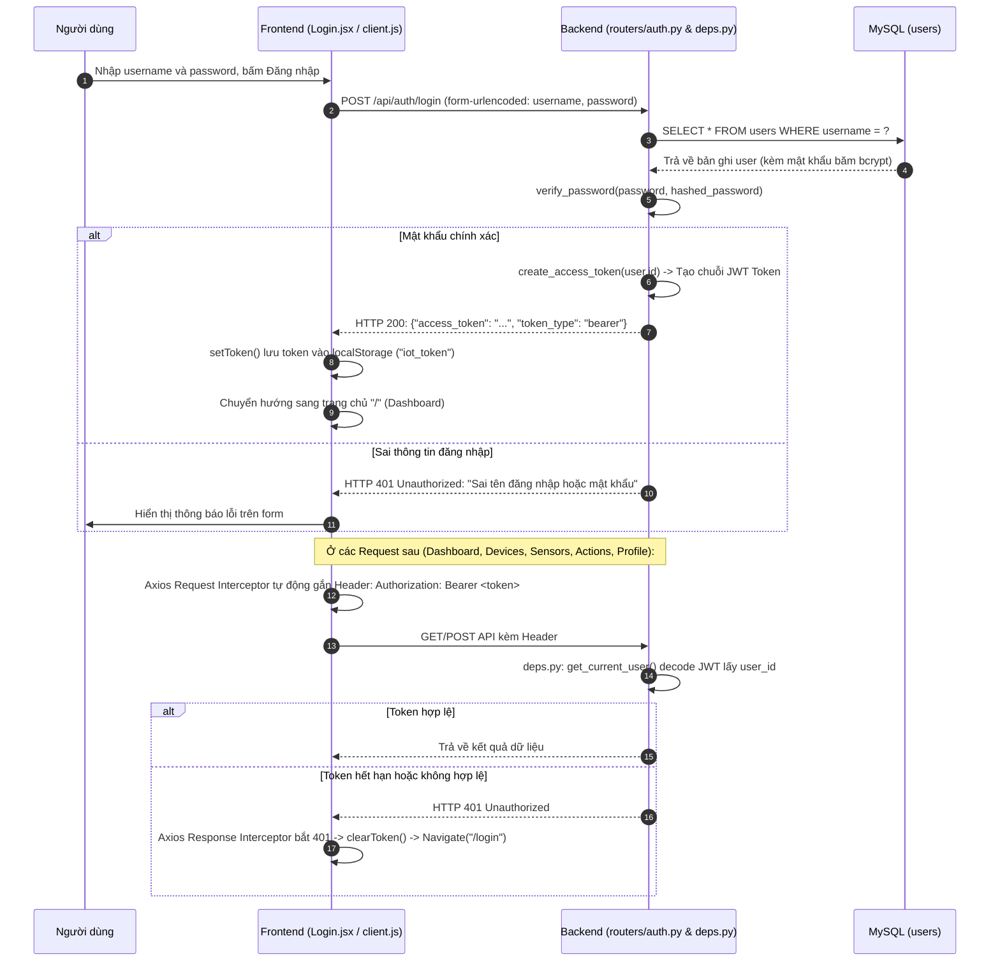
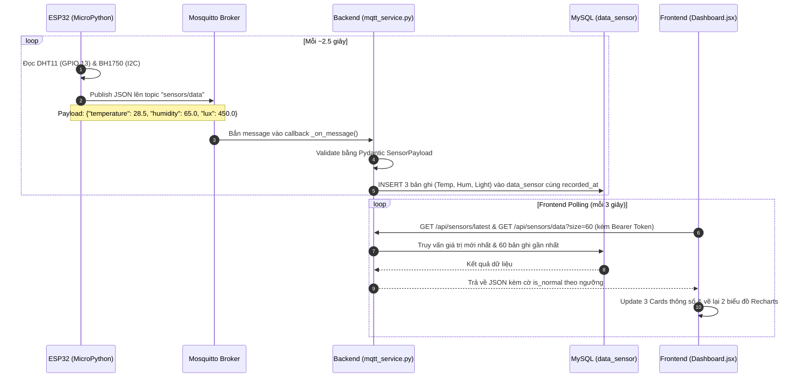
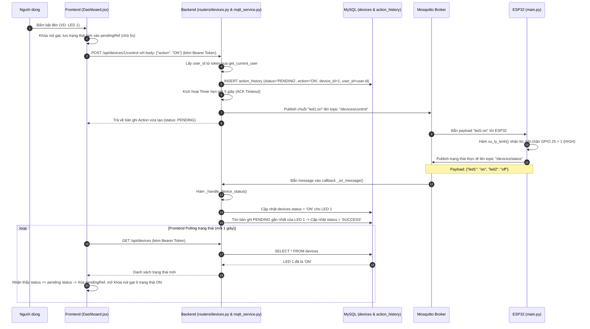
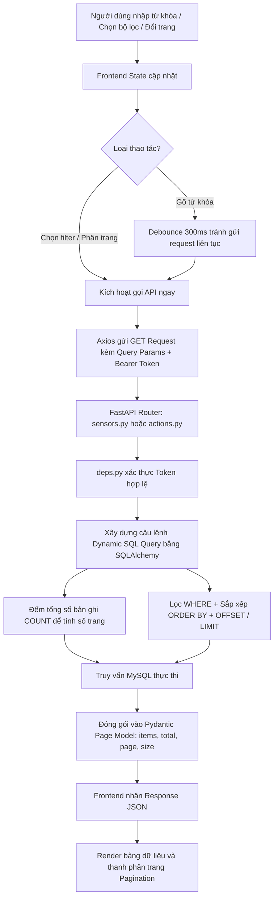

# 📘 TÀI LIỆU TOÀN DIỆN VỀ KIẾN TRÚC & LUỒNG HOẠT ĐỘNG DỰ ÁN SMART HOUSE

> **Mục tiêu tài liệu:** Giúp bạn đọc hiểu toàn bộ cấu trúc mã nguồn, vai trò cụ thể của từng tệp tin và nắm bắt chính xác 100% các luồng hoạt động (Data Flow, Control Flow & Authentication Flow) của hệ sinh thái Smart House trong thời gian ngắn nhất.

---

## 📑 MỤC LỤC
1. [Tổng quan Kiến trúc Hệ thống](#1-tổng-quan-kiến-trúc-hệ-thống)
2. [Bản đồ vai trò của từng File trong Project](#2-bản-đồ-vai-trò-của-từng-file-trong-project)
3. [Chi tiết các Luồng Hoạt Động (Core Workflows)](#3-chi-tiết-các-luồng-hoạt-động-core-workflows)
   - [Luồng 1: Đăng nhập & Xác thực bảo mật JWT (Authentication Flow)](#luồng-1-đăng-nhập--xác-thực-bảo-mật-jwt-authentication-flow)
   - [Luồng 2: Thu thập và hiển thị dữ liệu cảm biến (Sensor Real-time Flow)](#luồng-2-thu-thập-và-hiển-thị-dữ-liệu-cảm-biến-sensor-real-time-flow)
   - [Luồng 3: Điều khiển thiết bị và xác thực 2 chiều (Two-way Device Control Flow)](#luồng-3-điều-khiển-thiết-bị-và-xác-thực-2-chiều-two-way-device-control-flow)
   - [Luồng 4: Tìm kiếm, lọc và phân trang dữ liệu (Query, Filter & Pagination Flow)](#luồng-4-tìm-kiếm-lọc-và-phân-trang-dữ-liệu-query-filter--pagination-flow)
   - [Luồng 5: Quản lý Hồ sơ người dùng & Tài nguyên dự án (Profile Management Flow)](#luồng-5-quản-lý-hồ-sơ-người-dùng--tài-nguyên-dự-án-profile-management-flow)
4. [Mô hình Dữ liệu (Database Schema & Relationships)](#4-mô-hình-dữ-liệu-database-schema--relationships)
5. [Quy ước Giao thức & Danh mục RESTful API](#5-quy-ước-giao-thức--danh-mục-restful-api)
6. [Tóm tắt nhanh để bắt tay vào làm việc (Quick Cheatsheet)](#6-tóm-tắt-nhanh-để-bắt-tay-vào-làm-việc-quick-cheatsheet)

---

## 1. Tổng quan Kiến trúc Hệ thống

Dự án là một hệ sinh thái IoT hoàn chỉnh gồm **4 tầng kiến trúc**:

```
+--------------------------------------------------------------------------+
|                                1. HARDWARE LAYER                         |
|  ESP32 (MicroPython Firmware)                                            |
|  - Cảm biến DHT11 (GPIO 13): Nhiệt độ (°C), Độ ẩm (%)                    |
|  - Cảm biến BH1750 / GY-302 (I2C: GPIO 18 SCL, 19 SDA, 0x23): Ánh sáng    |
|  - 2x Đèn LED (GPIO 25: LED 1, GPIO 26: LED 2)                           |
+-----------------------------------^--------------------------------------+
                                    | WiFi / MQTT (Port 1883)
                                    v
+--------------------------------------------------------------------------+
|                           2. COMMUNICATION LAYER                         |
|  Mosquitto MQTT Broker (Port 1883)                                       |
|  - Topic `sensors/data`: ESP32 bắn số đo môi trường định kỳ (mỗi ~2.5s)  |
|  - Topic `/devices/control`: Backend phát lệnh bật/tắt thiết bị          |
|  - Topic `/devices/status`: ESP32 phản hồi trạng thái thực tế sau khi bật|
+-----------------------------------^--------------------------------------+
                                    | Paho MQTT Client (Background Thread)
                                    v
+--------------------------------------------------------------------------+
|                             3. BACKEND LAYER                             |
|  FastAPI (Python 3.10+) + SQLAlchemy 2.0 ORM + JWT Auth                  |
|  - Lắng nghe MQTT ngầm song song với HTTP Web Server                     |
|  - Bảo mật OAuth2 Bearer Token + JWT (HS256) + Mã hóa mật khẩu bcrypt     |
|  - Quản lý đồng bộ Database, hẹn giờ ACK Timeout (5s) cho lệnh điều khiển|
|  - Cung cấp RESTful API cho Frontend truy vấn & điều khiển               |
+-------------------^----------------------------------^-------------------+
                    | PyMySQL                          | HTTP REST (Port 8000)
                    v                                  v
+--------------------------------------+   +-------------------------------+
|         DATABASE LAYER               |   |      4. FRONTEND LAYER        |
|  MySQL Server 8.0 (`smart_house`)    |   |  React 19 + Vite (Port 5173)  |
|  - `users`: Tài khoản & Profile      |   |  - Đăng nhập & ProtectedRoute |
|  - `devices`: Trạng thái thiết bị    |   |  - Dashboard: Đồ thị Recharts |
|  - `sensors`: Danh mục & ngưỡng      |   |  - Data Sensor: Bảng lọc số đo|
|  - `data_sensor`: Dữ liệu lịch sử đo |   |  - Action History: Lịch sử log|
|  - `action_history`: Lịch sử bật/tắt |   |  - Profile: Hồ sơ sinh viên   |
+--------------------------------------+   +-------------------------------+
```

---

## 2. Bản đồ vai trò của từng File trong Project

| Đường dẫn tệp | Vai trò và chức năng cốt lõi |
| :--- | :--- |
| **THƯ MỤC GỐC** | |
| `README.md` | Tài liệu hướng dẫn cài đặt, chân cắm mạch, danh sách API. |
| `run.txt` | Bảng câu lệnh terminal tổng hợp khởi chạy toàn bộ hệ thống từ DB đến Web. |
| `qa.md` | Bộ câu hỏi thực hành livecode và vấn đáp cơ chế bảo vệ đồ án. |
| **DATABASE (`database/`)** | |
| `database/init.sql` | Tạo CSDL `smart_house`, tạo tài khoản MySQL và phân quyền người dùng. |
| `database/schema.sql` | DDL tạo 5 bảng (`users`, `devices`, `sensors`, `data_sensor`, `action_history`) kèm khóa ngoại và các chỉ mục `INDEX` tối ưu tìm kiếm theo thời gian. |
| `database/seed.sql` | Nạp sẵn danh mục 2 LED và 3 cảm biến (Temperature, Humidity, Light) kèm ngưỡng an toàn (`min_normal`, `max_normal`). |
| **ESP32 FIRMWARE (`esp32/`)** | |
| `esp32/secrets.py` | Chứa cấu hình kết nối WiFi (SSID, Password) và MQTT Broker (IP, Port, User, Pass). |
| `esp32/main.py` | **Entrypoint ESP32 MicroPython:** Khởi tạo I2C BH1750, chân DHT11 và 2 LED; kết nối WiFi & MQTT; lặp kiểm tra lệnh `/devices/control` để bật tắt GPIO 25, 26; định kỳ mỗi ~2.5s đọc và gửi gói tin JSON lên `sensors/data`; tự khôi phục kết nối khi rớt mạng. |
| **BACKEND FASTAPI (`backend/app/`)** | |
| `backend/app/config.py` | Quản lý biến môi trường bằng `pydantic-settings`, ghép chuỗi kết nối MySQL `database_url`, cấu hình `JWT_SECRET` và thời gian sống của token (`JWT_EXPIRE_MINUTES`). |
| `backend/app/database.py` | Khởi tạo SQLAlchemy `engine`, thiết lập connection pool (`pool_pre_ping=True`), `SessionLocal`, hàm dependency `get_db()`. |
| `backend/app/models.py` | Khai báo các ORM Entity class: `User`, `Device`, `Sensor`, `DataSensor`, `ActionHistory` và các Enum (`DeviceStatus`, `ActionType`, `ActionStatus`). |
| `backend/app/schemas.py` | Pydantic Schemas định dạng dữ liệu đầu vào/ra của API, parse gói tin JSON MQTT từ ESP32, định nghĩa `TokenOut`, `UserOut`. |
| `backend/app/security.py` | Các hàm bảo mật: `hash_password` (bcrypt), `verify_password`, `create_access_token` (JWT HS256), `decode_token`. |
| `backend/app/deps.py` | Dependency `get_current_user`: trích xuất Bearer token từ Header HTTP, decode và nạp thông tin đối tượng `User` từ database để bảo vệ các API. |
| `backend/app/mqtt_service.py` | **Cầu nối MQTT - Database:** Chạy Paho MQTT Client nền (`loop_start()`), nhận dữ liệu cảm biến lưu vào DB, nhận phản hồi trạng thái thiết bị, gửi lệnh điều khiển xuống ESP32 và hẹn giờ 5s (ACK Timeout) để đánh dấu `FAILED` nếu không có phản hồi. |
| `backend/app/main.py` | Khởi tạo ứng dụng FastAPI, quản lý vòng đời `lifespan` (bật/tắt MQTT service), phân quyền router công khai (`/api/auth/login`, `/api/health`) và router bảo vệ bằng JWT (`devices`, `sensors`, `actions`). |
| `backend/app/routers/auth.py` | Router `/api/auth`: Endpoint `POST /login` (xác thực username/password, trả về JWT access_token) và `GET /me` (lấy thông tin user đang đăng nhập). |
| `backend/app/routers/devices.py` | Router `/api/devices`: Endpoint `GET ""` (danh sách & trạng thái LED), `POST "/{device_id}/control"` (gửi lệnh bật/tắt thiết bị, ghi nhận chính xác `user_id` của người thực hiện). |
| `backend/app/routers/sensors.py` | Router `/api/sensors`: Endpoint `GET ""` (danh mục), `GET "/latest"` (giá trị mới nhất kèm `is_normal`), `GET "/data"` (lịch sử đo kèm lọc từ khóa đa trường, thời gian, sắp xếp, phân trang). |
| `backend/app/routers/actions.py` | Router `/api/actions`: Endpoint `GET ""` (lịch sử thao tác thiết bị, hỗ trợ tìm kiếm từ khóa `q` ở backend, lọc theo device, status, action, thời gian, phân trang). |
| `backend/create_user.py` | Script dòng lệnh độc lập giúp khởi tạo hoặc đổi mật khẩu cho user quản trị `baonguyenn2302` với mật khẩu mã hóa bcrypt an toàn. |
| `backend/app/seed_mock.py` | Script sinh dữ liệu đo mẫu và lịch sử thao tác vào trực tiếp MySQL để kiểm thử. |
| **FRONTEND REACT (`frontend/src/`)** | |
| `frontend/src/main.jsx` | Điểm khởi đầu của ứng dụng React, nạp CSS và `App.jsx`. |
| `frontend/src/App.jsx` | Định tuyến React Router: bọc các trang chính trong `ProtectedRoute` và trang `/login` công khai. |
| `frontend/src/index.css` | Hệ thống Design System toàn cục: biến CSS màu sắc dark/light, bố cục sidebar, bảng biểu, switch, card, form đăng nhập. |
| `frontend/src/utils/auth.js` | Quản lý lưu trữ token đăng nhập trong `localStorage` (`getToken`, `setToken`, `clearToken`, `isLoggedIn`). |
| `frontend/src/components/ProtectedRoute.jsx` | Component bảo vệ: kiểm tra xem người dùng đã có token hợp lệ chưa, nếu chưa tự động điều hướng về `/login`. |
| `frontend/src/components/Layout.jsx` | Khung giao diện chung chứa Sidebar điều hướng (Dashboard, Data Sensor, Action History, Profile) và nút Đăng xuất. |
| `frontend/src/components/Pagination.jsx` | Thanh phân trang tái sử dụng (chọn trang, chọn page size: 10, 20, 50, 100). |
| `frontend/src/api/client.js` | Cấu hình Axios instance `/api`, cài đặt **Request Interceptor** (tự động đính kèm `Bearer <token>`) và **Response Interceptor** (bắt mã 401 để xóa token và chuyển về trang Login). |
| `frontend/src/pages/Login.jsx` | Trang đăng nhập: form nhập username, password, gọi API `/api/auth/login`, lưu token và chuyển hướng vào Dashboard. |
| `frontend/src/pages/Dashboard.jsx` | **Trang chủ:** Polling cảm biến (mỗi 3s), polling thiết bị (mỗi 1s); hiển thị 3 Card chỉ số cảm biến; vẽ 2 biểu đồ Recharts (Nhiệt độ - Độ ẩm & Ánh sáng); công tắc điều khiển 2 LED có hiệu ứng khóa chờ phản hồi (`pendingRef`). |
| `frontend/src/pages/DataSensor.jsx` | Trang bảng lịch sử đo: hỗ trợ tìm kiếm debounce 300ms, chọn trường tìm kiếm (All, Time, Temp, Hum, Light), sắp xếp và phân trang. |
| `frontend/src/pages/ActionHistory.jsx` | Trang lịch sử thao tác: tìm kiếm từ khóa `q` trực tiếp xuống backend, lọc theo thiết bị, theo trạng thái hành động (SUCCESS, PENDING, FAILED), theo hành động (ON, OFF), sắp xếp và phân trang. |
| `frontend/src/pages/Profile.jsx` | Trang hồ sơ người dùng: gọi API `/api/auth/me` để lấy thông tin sinh viên từ cơ sở dữ liệu và hiển thị liên kết tài nguyên đồ án (GitHub, Figma, PDF). |

---

## 3. Chi tiết các Luồng Hoạt Động (Core Workflows)

### Luồng 1: Đăng nhập & Xác thực bảo mật JWT (Authentication Flow)

Toàn bộ hệ thống được bảo vệ bởi cơ chế xác thực JWT chuẩn OAuth2 Bearer. Người dùng bắt buộc phải đăng nhập thành công mới có thể xem dữ liệu và điều khiển thiết bị.



#### Các file tham gia:
- `frontend/src/pages/Login.jsx`: Giao diện đăng nhập.
- `frontend/src/utils/auth.js`: Đọc/ghi `localStorage`.
- `frontend/src/api/client.js`: Gắn token tự động vào header và bắt 401 để logout.
- `backend/app/security.py`: Mã hóa và kiểm tra mật khẩu bằng bcrypt, tạo và giải mã JWT token.
- `backend/app/deps.py`: Middleware kiểm tra token trước khi vào endpoint.
- `backend/app/routers/auth.py`: Endpoint đăng nhập `/api/auth/login` và lấy hồ sơ `/api/auth/me`.

---

### Luồng 2: Thu thập và hiển thị dữ liệu cảm biến (Sensor Real-time Flow)

Luồng hoạt động tự động một chiều từ phần cứng ESP32 lên cơ sở dữ liệu và hiển thị lên giao diện Web.



#### Các file tham gia:
1. `esp32/main.py`: Hàm `doc_va_gui_cam_bien()` đọc cảm biến và gửi JSON tới `sensors/data`.
2. `backend/app/mqtt_service.py`: Lắng nghe tin nhắn từ Broker, trích xuất dữ liệu và lưu trực tiếp vào bảng `data_sensor` bằng SQLAlchemy SessionLocal.
3. `backend/app/routers/sensors.py`:
   - `GET /api/sensors/latest`: Trả về giá trị mới nhất kèm trường `is_normal` để đánh giá ngưỡng an toàn.
   - `GET /api/sensors/data`: Cung cấp lịch sử dữ liệu phục vụ vẽ 2 biểu đồ đường trên Dashboard.
4. `frontend/src/pages/Dashboard.jsx`: Gọi 2 API trên mỗi 3s, nhóm các bản ghi cùng thời điểm thành 1 điểm thời gian (`toSeries()`) để hiển thị liên tục 10 mốc thời gian gần nhất trên Recharts.

---

### Luồng 3: Điều khiển thiết bị và xác thực 2 chiều (Two-way Device Control Flow)

Hệ thống **không cập nhật trạng thái thiết bị ngay lập tức** khi bấm nút, mà áp dụng cơ chế xác nhận 2 chiều (Pending Confirmation) kèm Timeout để đảm bảo đúng trạng thái thực tế của phần cứng, đồng thời lưu vết chính xác người thực hiện thao tác.



#### Xử lý kịch bản lỗi (ESP32 mất nguồn hoặc mất mạng):
1. Backend gửi lệnh lên MQTT nhưng ESP32 không nhận được.
2. Quá 5 giây, `threading.Timer` trong `mqtt_service.py` gọi hàm `_mark_failed_if_pending()`.
3. Bản ghi trong bảng `action_history` tự động được chuyển thành `FAILED`.
4. Trên giao diện Frontend, `pendingRef` hết hạn 5 giây, switch tự động trả về trạng thái cũ thực tế của thiết bị trong DB.

#### Các file tham gia:
- `frontend/src/pages/Dashboard.jsx`: Bắt sự kiện người dùng bấm switch `toggleDevice()`, gọi `api.post("/devices/{id}/control", { action })`.
- `backend/app/routers/devices.py`: Tiếp nhận request, lấy `user.id` từ token qua `get_current_user`, gọi `send_device_command()`.
- `backend/app/mqtt_service.py`: Ghi bản ghi `ActionHistory` (kèm `user_id`), publish lệnh qua MQTT và khởi tạo `threading.Timer(ACK_TIMEOUT_SECONDS = 5, _mark_failed_if_pending)`. Khi ESP32 phản hồi lên `/devices/status`, hàm `_handle_device_status()` cập nhật thiết bị và chốt trạng thái `SUCCESS`.
- `esp32/main.py`: Nhận lệnh qua `xu_ly_lenh()`, kích chân GPIO `led1.value(1)` hoặc `led1.value(0)`, sau đó gọi ngay `gui_trang_thai_led()` gửi JSON lên `/devices/status`.

---

### Luồng 4: Tìm kiếm, lọc và phân trang dữ liệu (Query, Filter & Pagination Flow)

Phục vụ cho 2 màn hình quản lý bảng: **Data Sensor** (quản lý số liệu cảm biến) và **Action History** (quản lý nhật ký thao tác thiết bị).



#### Các tiêu chí lọc hỗ trợ:
- **Tại Data Sensor (`/sensors`):**
  - Tìm kiếm theo trường: `ALL`, `TIME`, `TEMPERATURE`, `HUMIDITY`, `LIGHT`.
  - Sắp xếp: Mới nhất (`TIME_DESC`), Cũ nhất (`TIME_ASC`), Giá trị cao -> thấp (`VALUE_DESC`), Giá trị thấp -> cao (`VALUE_ASC`).
  - Lọc theo khoảng thời gian (`from_time`, `to_time`).
  - Phân trang: Số lượng dòng/trang (10, 20, 50, 100).
- **Tại Action History (`/actions`):**
  - Tìm kiếm từ khóa `q` trực tiếp trên Server: tìm theo tên thiết bị, tên người thao tác (`full_name`, `username`), loại hành động (`ON`/`OFF`), trạng thái (`SUCCESS`/`PENDING`/`FAILED`), thời gian.
  - Lọc theo thiết bị (`device_id`).
  - Lọc theo trạng thái kết quả (`status`: SUCCESS, PENDING, FAILED).
  - Lọc theo hành động (`action`: ON, OFF).
  - Sắp xếp theo thời gian (`TIME_DESC`, `TIME_ASC`).

#### Các file tham gia:
- Frontend: `DataSensor.jsx`, `ActionHistory.jsx`, `Pagination.jsx`.
- Backend: `routers/sensors.py`, `routers/actions.py`, `schemas.py` (`Page[T]`).

---

### Luồng 5: Quản lý Hồ sơ người dùng & Tài nguyên dự án (Profile Management Flow)

```
[ Frontend Profile.jsx ] 
         │ 
         │ (Gửi GET /api/auth/me kèm Bearer Token)
         ▼
[ Backend routers/auth.py ]
         │ 
         │ (deps.py giải mã token -> lấy user_id)
         ▼
[ MySQL users table ]
         │ 
         │ (Truy vấn: username, full_name, student_id, class_name, email, phone, avatar, links)
         ▼
[ Frontend Profile.jsx ]
         │
         ├──> Render thông tin cá nhân: Họ tên, Mã sinh viên, Lớp, Khoa, Email, SĐT
         └──> Render Project Resources: Nút mở GitHub, Nút mở Figma, Nút tải PDF SRS
```

#### Các file tham gia:
- `backend/create_user.py`: Script khởi tạo/cập nhật thông tin sinh viên `baonguyenn2302` và mã hóa mật khẩu.
- `backend/app/routers/auth.py`: Endpoint `GET /api/auth/me` trả về thông tin `UserOut`.
- `frontend/src/pages/Profile.jsx`: Giao diện hiển thị hồ sơ động từ API.

---

## 4. Mô hình Dữ liệu (Database Schema & Relationships)

CSDL `smart_house` được thiết kế chuẩn hóa gồm 5 bảng:

```
       +-------------------+
       |       users       |
       +-------------------+
       | id (PK)           |
       | username          |
       | password (bcrypt) |
       | full_name         |
       | student_id        |
       | class_name        |
       | faculty, email    |
       | phone, avatar     |
       | links (JSON)      |
       +---------+---------+
                 | 1
                 | 
                 | N (user_id: SET NULL)
       +---------v---------+               +-------------------+
       |  action_history   |               |      devices      |
       +-------------------+               +-------------------+
       | id (PK)           | N           1 | id (PK)           |
       | action (ON/OFF)   +---------------> name (LED 1, 2)   |
       | status (PEND/SUC) | (device_id)   | status (ON/OFF)   |
       | recorded_at       |               +-------------------+
       | user_id (FK)      |
       | device_id (FK)    |
       +-------------------+

       +-------------------+
       |      sensors      |
       +-------------------+
       | id (PK)           |
       | name (Temp, ...)  |
       | unit (°C, %, lux) |
       | min_normal        |
       | max_normal        |
       +---------+---------+
                 | 1
                 |
                 | N (sensor_id: CASCADE)
       +---------v---------+
       |    data_sensor    |
       +-------------------+
       | id (PK)           |
       | value (Double)    |
       | recorded_at       |
       | sensor_id (FK)    |
       +-------------------+
```

### Các quy tắc thiết kế CSDL:
1. **Chỉ số hiệu năng (Indexes):**
   - `idx_sensor_time (sensor_id, recorded_at)` và `idx_time (recorded_at)` trên bảng `data_sensor` giúp tăng tốc độ vẽ biểu đồ và truy vấn lịch sử khi dữ liệu lớn lên hàng chục ngàn dòng.
   - `idx_action_device_time`, `idx_action_status` và `idx_action_time` trên bảng `action_history` giúp truy vấn nhanh các lệnh đang `PENDING` và lọc lịch sử.
2. **Khóa ngoại an toàn:**
   - Xóa sensor thì tự động xóa lịch sử đo liên quan (`ON DELETE CASCADE`).
   - Xóa user thì lịch sử thao tác vẫn được giữ lại với `user_id = NULL` (`ON DELETE SET NULL`, hiển thị là "Hệ thống").
   - Thiết bị được bảo toàn toàn vẹn tham chiếu.

---

## 5. Quy ước Giao thức & Danh mục RESTful API

### A. MQTT Topics
| Topic | Bên gửi | Bên nhận | Định dạng | Ví dụ Payload | Chức năng |
| :--- | :---: | :---: | :---: | :--- | :--- |
| `sensors/data` | ESP32 | Backend | JSON | `{"temperature": 28.5, "humidity": 65.0, "lux": 450.0}` | ESP32 publish số đo cảm biến mỗi ~2.5 giây. |
| `/devices/control` | Backend | ESP32 | Plain Text | `led1:on`, `led1:off`, `led2:on`, `led2:off`, `all:on`, `all:off` | Backend gửi lệnh điều khiển xuống ESP32. |
| `/devices/status` | ESP32 | Backend | JSON | `{"led1": "on", "led2": "off"}` | ESP32 phản hồi trạng thái thực tế để Backend chốt `SUCCESS`. |

### B. RESTful API Endpoints
| STT | Phương thức | Endpoint | Yêu cầu Auth | Mô tả chức năng | Request Body / Query Params |
| :---: | :---: | :--- | :---: | :--- | :--- |
| **I. Phân hệ Xác thực** | | | | | |
| 1 | `POST` | `/api/auth/login` | Không | Đăng nhập hệ thống, trả về access_token JWT | `username`, `password` (OAuth2 Password Form) |
| 2 | `GET` | `/api/auth/me` | Có (Bearer) | Lấy thông tin hồ sơ của user đang đăng nhập | Không |
| **II. Phân hệ Thiết bị** | | | | | |
| 3 | `GET` | `/api/devices` | Có (Bearer) | Lấy danh sách thiết bị và trạng thái hiện tại | Không |
| 4 | `POST` | `/api/devices/{id}/control` | Có (Bearer) | Gửi lệnh bật/tắt thiết bị (lưu log kèm user_id) | `{"action": "ON"}` hoặc `{"action": "OFF"}` |
| **III. Phân hệ Cảm biến** | | | | | |
| 5 | `GET` | `/api/sensors` | Có (Bearer) | Lấy danh mục cảm biến và ngưỡng bình thường | Không |
| 6 | `GET` | `/api/sensors/latest` | Có (Bearer) | Lấy giá trị mới nhất của cả 3 cảm biến kèm `is_normal` | Không |
| 7 | `GET` | `/api/sensors/data` | Có (Bearer) | Lấy lịch sử đo cảm biến (biểu đồ và bảng lọc) | `q`, `field`, `sensor_id`, `from`, `to`, `sort`, `page`, `size` |
| **IV. Phân hệ Lịch sử Thao tác** | | | | | |
| 8 | `GET` | `/api/actions` | Có (Bearer) | Lấy danh sách lịch sử thao tác bật/tắt thiết bị | `q`, `device_id`, `status`, `action`, `from`, `to`, `sort`, `page`, `size` |
| **V. Phân hệ Hệ thống** | | | | | |
| 9 | `GET` | `/api/health` | Không | Kiểm tra trạng thái máy chủ và kết nối MQTT Broker | Không |

---

## 6. Tóm tắt nhanh để bắt tay vào làm việc (Quick Cheatsheet)

Khi bạn muốn kiểm tra hoặc chỉnh sửa một tính năng cụ thể, hãy xem bảng tra cứu nhanh dưới đây:

| Bạn muốn làm gì? | File cần xem / chỉnh sửa |
| :--- | :--- |
| Tạo mới hoặc đổi mật khẩu đăng nhập cho user | Chạy lệnh `python backend/create_user.py` |
| Đổi thời gian sống của token JWT hoặc Secret Key | `backend/app/config.py` (`JWT_SECRET`, `JWT_EXPIRE_MINUTES`) |
| Sửa logic phân quyền hoặc giải mã token | `backend/app/security.py` và `backend/app/deps.py` |
| Đổi chân GPIO cảm biến hoặc LED trên ESP32 | `esp32/main.py` (các dòng 22 - 38) |
| Đổi chu kỳ gửi dữ liệu cảm biến từ mạch | `esp32/main.py` (dòng 181: đổi số vòng chia dư) |
| Đổi cấu hình kết nối DB hoặc MQTT broker | `backend/.env.example` & `backend/app/config.py` |
| Chỉnh thời gian timeout chờ lệnh bật/tắt (ACK Timeout) | `backend/app/mqtt_service.py` (`ACK_TIMEOUT_SECONDS = 5`) |
| Thêm/bớt trường dữ liệu hoặc bảng mới | `database/schema.sql` và `backend/app/models.py` |
| Thêm bộ lọc hoặc đổi tiêu chí tìm kiếm API | `backend/app/routers/sensors.py` hoặc `backend/app/routers/actions.py` |
| Đổi giao diện trang Login | `frontend/src/pages/Login.jsx` và `frontend/src/index.css` |
| Đổi màu sắc, biểu đồ hoặc giao diện Dashboard | `frontend/src/pages/Dashboard.jsx` và `frontend/src/index.css` |
| Đổi chu kỳ tự động làm mới (Polling) trên Web | `frontend/src/pages/Dashboard.jsx` (`SENSOR_POLL_MS`, `DEVICE_POLL_MS`) |
