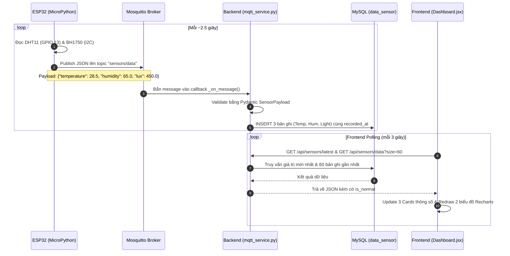
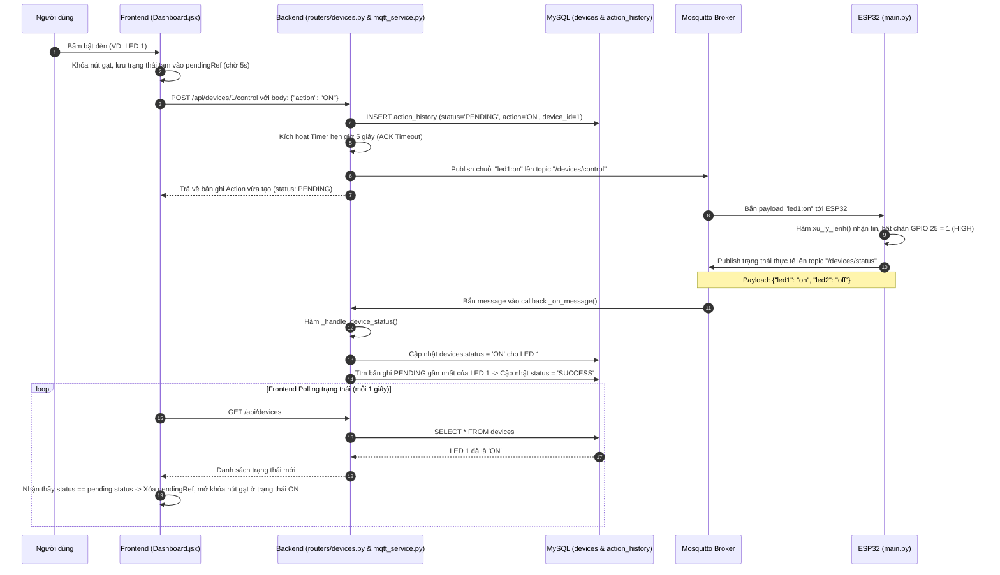
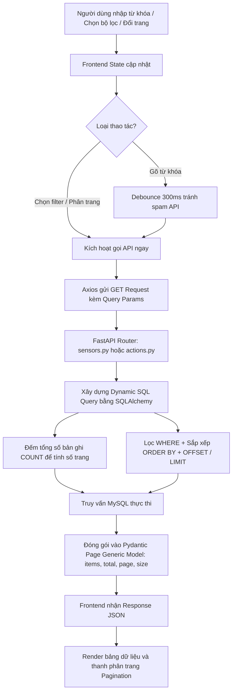

# 📘 TÀI LIỆU TOÀN DIỆN VỀ KIẾN TRÚC & LUỒNG HOẠT ĐỘNG DỰ ÁN SMART HOUSE

> **Mục tiêu tài liệu:** Giúp bạn đọc hiểu toàn bộ cấu trúc mã nguồn, vai trò cụ thể của từng tệp tin và nắm bắt chính xác 100% các luồng hoạt động (Data Flow) của hệ sinh thái Smart House trong thời gian ngắn nhất.

---

## 📑 MỤC LỤC
1. [Tổng quan Kiến trúc Hệ thống](#1-tổng-quan-kiến-trúc-hệ-thống)
2. [Bản đồ vai trò của từng File trong Project](#2-bản-đồ-vai-trò-của-từng-file-trong-project)
3. [Chi tiết các Luồng Hoạt Động (Data & Control Flows)](#3-chi-tiết-các-luồng-hoạt-động-data--control-flows)
   - [Luồng 1: Thu thập và hiển thị dữ liệu cảm biến (Sensor Flow)](#luồng-1-thu-thập-và-hiển-thị-dữ-liệu-cảm-biến-sensor-flow)
   - [Luồng 2: Điều khiển thiết bị và xác thực 2 chiều (Two-way Control Flow)](#luồng-2-điều-khiển-thiết-bị-và-xác-thực-2-chiều-two-way-control-flow)
   - [Luồng 3: Tìm kiếm, lọc và phân trang (Search, Filter & Pagination Flow)](#luồng-3-tìm-kiếm-lọc-và-phân-trang-search-filter--pagination-flow)
   - [Luồng 4: Chế độ Mock Data kiểm thử giao diện độc lập (Mock Adapter Flow)](#luồng-4-chế-độ-mock-data-kiểm-thử-giao-diện-độc-lập-mock-adapter-flow)
4. [Mô hình Dữ liệu (Database Schema & Relationships)](#4-mô-hình-dữ-liệu-database-schema--relationships)
5. [Quy ước Giao thức & Định dạng Payload](#5-quy-ước-giao-thức--định-dạng-payload)
6. [Tóm tắt nhanh để bắt tay vào làm việc (Quick Cheatsheet)](#6-tóm-tắt-nhanh-để-bắt-tay-vào-làm-việc-quick-cheatsheet)

---

## 1. Tổng quan Kiến trúc Hệ thống

Dự án là một hệ sinh thái IoT hoàn chỉnh gồm **4 tầng kiến trúc**:

```
+--------------------------------------------------------------------------+
|                                1. HARDWARE LAYER                         |
|  ESP32 (MicroPython)                                                     |
|  - Cảm biến DHT11 (GPIO 13): Nhiệt độ, Độ ẩm                             |
|  - Cảm biến BH1750 / GY-302 (I2C: GPIO 18 SCL, 19 SDA): Cường độ sáng   |
|  - 2x Đèn LED (GPIO 25: LED 1, GPIO 26: LED 2)                           |
+-----------------------------------^--------------------------------------+
                                    | WiFi / MQTT (Port 1883)
                                    v
+--------------------------------------------------------------------------+
|                           2. COMMUNICATION LAYER                         |
|  Mosquitto MQTT Broker                                                   |
|  - Topic `sensors/data`: ESP32 bắn số đo môi trường định kỳ (mỗi ~2.5s)  |
|  - Topic `/devices/control`: Backend phát lệnh bật/tắt thiết bị          |
|  - Topic `/devices/status`: ESP32 phản hồi trạng thái thực tế sau khi bật|
+-----------------------------------^--------------------------------------+
                                    | Paho MQTT Client (Background Thread)
                                    v
+--------------------------------------------------------------------------+
|                             3. BACKEND LAYER                             |
|  FastAPI (Python) + SQLAlchemy 2.0 ORM + Pydantic v2                     |
|  - Lắng nghe sự kiện MQTT chạy song song với HTTP Web Server             |
|  - Quản lý đồng bộ Database, hẹn giờ ACK Timeout (5s) cho lệnh           |
|  - Cung cấp RESTful API cho Frontend truy vấn & điều khiển               |
+-------------------^----------------------------------^-------------------+
                    | PyMySQL                          | HTTP REST (Port 8000)
                    v                                  v
+--------------------------------------+   +-------------------------------+
|         DATABASE LAYER               |   |      4. FRONTEND LAYER        |
|  MySQL Server (`smart_house`)        |   |  React 19 + Vite (Port 5173)  |
|  - `users`: Tài khoản sinh viên      |   |  - Dashboard: Đồ thị Recharts |
|  - `devices`: Trạng thái thiết bị    |   |  - Data Sensor: Bảng lọc số đo|
|  - `sensors`: Danh mục & ngưỡng      |   |  - Action History: Lịch sử    |
|  - `data_sensor`: Dữ liệu lịch sử đo |   |  - Profile: Thông tin tác giả |
|  - `action_history`: Lịch sử bật/tắt |   |  - Mock Adapter giả lập       |
+--------------------------------------+   +-------------------------------+
```

---

## 2. Bản đồ vai trò của từng File trong Project

| Đường dẫn tệp | Vai trò và chức năng cốt lõi |
| :--- | :--- |
| **THƯ MỤC GỐC** | |
| `README.md` | Tài liệu hướng dẫn cài đặt, chân cắm mạch, danh sách API. |
| `run.txt` | Tập hợp các câu lệnh terminal khởi chạy tất cả các thành phần. |
| **DATABASE (`database/`)** | |
| `database/init.sql` | Tạo CSDL `smart_house`, tạo tài khoản MySQL và phân quyền. |
| `database/schema.sql` | DDL tạo 5 bảng (`users`, `devices`, `sensors`, `data_sensor`, `action_history`) kèm khoá ngoại và các chỉ mục `INDEX` tối ưu tìm kiếm theo thời gian. |
| `database/seed.sql` | Nạp sẵn danh mục 2 LED và 3 cảm biến (Temperature, Humidity, Light) kèm ngưỡng an toàn (`min_normal`, `max_normal`). |
| **ESP32 FIRMWARE (`esp32/`)** | |
| `esp32/secrets.py` | Chứa thông tin đăng nhập WiFi SSID, Password và MQTT Broker IP/User/Pass. |
| `esp32/main.py` | **Entrypoint ESP32 MicroPython:** Đọc I2C BH1750, đọc GPIO DHT11; kết nối WiFi & MQTT; lặp kiểm tra lệnh `/devices/control` để bật tắt GPIO 25, 26; định kỳ mỗi ~2.5s gửi gói tin JSON lên `sensors/data`; tự reconnect khi mất mạng. |
| **BACKEND FASTAPI (`backend/app/`)** | |
| `backend/app/config.py` | Dùng `pydantic-settings` load cấu hình từ `.env`, tự ghép chuỗi kết nối MySQL `database_url`. |
| `backend/app/database.py` | Khởi tạo SQLAlchemy `engine`, kết nối connection pool (`pool_pre_ping=True`), `SessionLocal`, hàm dependency `get_db()`. |
| `backend/app/models.py` | Khai báo các ORM Entity class: `User`, `Device`, `Sensor`, `DataSensor`, `ActionHistory` và các Enum (`DeviceStatus`, `ActionType`, `ActionStatus`). |
| `backend/app/schemas.py` | Pydantic Schema định dạng dữ liệu đầu vào/ra của API và parse gói tin JSON MQTT từ ESP32. |
| `backend/app/mqtt_service.py` | **Cầu nối MQTT - Database:** Chạy Paho MQTT Client nền, nhận dữ liệu cảm biến lưu vào DB, nhận phản hồi trạng thái thiết bị, gửi lệnh điều khiển xuống ESP32 và kích hoạt bộ hẹn giờ 5s (ACK Timeout) để đổi `PENDING` thành `FAILED` nếu không có phản hồi. |
| `backend/app/main.py` | Khởi tạo ứng dụng FastAPI, quản lý vòng đời `lifespan` (tự bật MQTT khi start, ngắt khi shutdown), gộp các routers và tạo endpoint `/api/health`. |
| `backend/app/routers/devices.py` | Các endpoint: `GET /api/devices` (danh sách & trạng thái LED), `POST /api/devices/{id}/control` (gửi lệnh bật/tắt thiết bị). |
| `backend/app/routers/sensors.py` | Các endpoint: `GET /api/sensors` (danh mục), `GET /api/sensors/latest` (giá trị mới nhất kèm `is_normal`), `GET /api/sensors/data` (lịch sử đo kèm lọc theo từ khóa, trường, thời gian, sắp xếp, phân trang). |
| `backend/app/routers/actions.py` | Endpoint: `GET /api/actions` (lịch sử bật/tắt thiết bị, lọc theo device, status, action, thời gian, phân trang). |
| `backend/app/seed_mock.py` | Script độc lập sinh dữ liệu mô phỏng cảm biến và lịch sử bật/tắt vào trực tiếp MySQL để kiểm thử. |
| **FRONTEND REACT (`frontend/src/`)** | |
| `frontend/src/main.jsx` | Điểm khởi đầu của React DOM, nạp `App.jsx` và CSS toàn cục. |
| `frontend/src/App.jsx` | Cấu hình định tuyến React Router (`/`, `/sensors`, `/actions`, `/profile`). |
| `frontend/src/index.css` | Hệ thống biến CSS (Design Tokens), giao diện dark/light, responsive, card, switch, biểu đồ, bảng. |
| `frontend/src/components/Layout.jsx` | Khung giao diện chung chứa Sidebar điều hướng cố định và khu vực hiển thị trang con. |
| `frontend/src/components/Pagination.jsx` | Thanh phân trang tái sử dụng (chọn trang, chọn page size: 10, 20, 50, 100). |
| `frontend/src/api/client.js` | Cấu hình Axios instance `/api`. **Đặc biệt:** tích hợp sẵn `mockAdapter` giả lập toàn bộ backend và ESP32 sinh số liệu tự động cứ mỗi 2.5s để dev UI không cần phụ thuộc phần cứng. |
| `frontend/src/pages/Dashboard.jsx` | **Trang chủ:** Polling cảm biến (mỗi 3s), polling thiết bị (mỗi 1s); hiển thị 3 Card chỉ số cảm biến kèm cảnh báo ngưỡng; vẽ 2 biểu đồ Recharts (Nhiệt độ - Độ ẩm & Ánh sáng); cụm công tắc bật/tắt 2 đèn LED có hiệu ứng chờ phản hồi (`pending`). |
| `frontend/src/pages/DataSensor.jsx` | Trang bảng lịch sử đo: hỗ trợ tìm kiếm debounce, chọn trường tìm kiếm (All, Time, Temp, Hum, Light), sắp xếp và phân trang. |
| `frontend/src/pages/ActionHistory.jsx` | Trang lịch sử thao tác: lọc theo thiết bị, theo trạng thái hành động (SUCCESS, PENDING, FAILED), theo hành động (ON, OFF), sắp xếp và phân trang. |
| `frontend/src/pages/Profile.jsx` | Trang thông tin sinh viên nghiên cứu, liên kết đến GitHub repo, Figma và tài liệu báo cáo PDF. |

---

## 3. Chi tiết các Luồng Hoạt Động (Data & Control Flows)

### Luồng 1: Thu thập và hiển thị dữ liệu cảm biến (Sensor Flow)

Đây là luồng hoạt động tự động một chiều từ phần cứng lên cơ sở dữ liệu và hiển thị lên màn hình người dùng.



#### Các file tham gia trong luồng:
1. `esp32/main.py`: Hàm `doc_va_gui_cam_bien()` gọi `dht_sensor.measure()` và `bh1750_read_lux()`, đóng gói JSON và publish tới topic `sensors/data`.
2. `backend/app/mqtt_service.py`: Hàm `_on_message()` nhận topic `sensors/data`, gọi `_handle_sensor_data()`. Hàm này ánh xạ các key `temperature`, `humidity`, `lux` sang tên `Temperature`, `Humidity`, `Light` trong DB và thực hiện `db.add(DataSensor(...))`.
3. `backend/app/routers/sensors.py`:
   - Endpoint `latest_values()` lấy bản ghi mới nhất của từng cảm biến, so sánh với `min_normal`, `max_normal` để tính toán trường `is_normal` (true/false).
   - Endpoint `list_sensor_data()` cung cấp dữ liệu lịch sử cho Recharts.
4. `frontend/src/pages/Dashboard.jsx`: Hàm `loadSensors()` định kỳ gọi 2 API trên mỗi 3 giây, gom 3 bản ghi cảm biến có cùng timestamp thành 1 điểm dữ liệu thời gian (`toSeries()`) để hiển thị trên biểu đồ.

---

### Luồng 2: Điều khiển thiết bị và xác thực 2 chiều (Two-way Control Flow)

Hệ thống **không cập nhật trạng thái thiết bị ngay lập tức** khi bấm nút, mà áp dụng cơ chế xác nhận 2 chiều (Pending Confirmation) kèm Timeout để đảm bảo tính toàn vẹn phần cứng.



#### Xử lý kịch bản lỗi (ESP32 mất nguồn hoặc mất mạng):
1. Backend gửi lệnh lên MQTT nhưng ESP32 không nhận được.
2. Quá 5 giây, `threading.Timer` trong `mqtt_service.py` gọi hàm `_mark_failed_if_pending()`.
3. Bản ghi trong bảng `action_history` tự động được chuyển thành `FAILED`.
4. Trên giao diện Frontend, `pendingRef` hết hạn 5 giây, switch tự động trả về trạng thái cũ thực tế của thiết bị trong DB.

#### Các file tham gia trong luồng:
- `frontend/src/pages/Dashboard.jsx`: Bắt sự kiện người dùng bấm switch `toggleDevice()`, gọi `api.post("/devices/{id}/control", { action })`.
- `backend/app/routers/devices.py`: Tiếp nhận request, gọi `send_device_command()`.
- `backend/app/mqtt_service.py`: Ghi bản ghi `ActionHistory` trạng thái `PENDING`, publish lệnh qua MQTT và khởi tạo `threading.Timer(ACK_TIMEOUT_SECONDS, _mark_failed_if_pending)`. Khi ESP32 phản hồi lên `/devices/status`, hàm `_handle_device_status()` cập nhật thiết bị và chốt trạng thái `SUCCESS`.
- `esp32/main.py`: Nhận lệnh qua `xu_ly_lenh()`, kích chân GPIO `led1.value(1)` hoặc `led1.value(0)`, sau đó gọi ngay `gui_trang_thai_led()` gửi JSON lên `/devices/status`.

---

### Luồng 3: Tìm kiếm, lọc và phân trang (Search, Filter & Pagination Flow)

Luồng này phục vụ cho 2 màn hình: **Data Sensor** (quản lý số liệu cảm biến) và **Action History** (quản lý nhật ký người dùng).



#### Các tiêu chí lọc hỗ trợ:
- **Tại Data Sensor (`/sensors`):**
  - Tìm kiếm theo trường: `ALL`, `TIME`, `TEMPERATURE`, `HUMIDITY`, `LIGHT`.
  - Sắp xếp: Mới nhất (`TIME_DESC`), Cũ nhất (`TIME_ASC`), Giá trị cao -> thấp (`VALUE_DESC`), Giá trị thấp -> cao (`VALUE_ASC`).
  - Lọc theo khoảng thời gian (`from_time`, `to_time`).
  - Phân trang: Số lượng dòng/trang (10, 20, 50, 100).
- **Tại Action History (`/actions`):**
  - Lọc theo thiết bị (`device_id`).
  - Lọc theo kết quả thực thi (`status`: SUCCESS, PENDING, FAILED).
  - Lọc theo hành động (`action`: ON, OFF).
  - Sắp xếp theo thời gian (`TIME_DESC`, `TIME_ASC`).

#### Các file tham gia:
- Frontend: `DataSensor.jsx`, `ActionHistory.jsx`, `Pagination.jsx`.
- Backend: `routers/sensors.py`, `routers/actions.py`, `schemas.py` (`Page[T]`).

---

### Luồng 4: Chế độ Mock Data kiểm thử giao diện độc lập (Mock Adapter Flow)

Dự án được tích hợp sẵn một cơ chế cực kỳ hữu ích cho việc phát triển giao diện: **Frontend có thể chạy độc lập 100% không cần bật Backend hay cắm ESP32**.

```
[ Frontend Component ] 
         │ (gọi api.get / api.post)
         ▼
[ frontend/src/api/client.js ]
         │ 
         ├──> Kiểm tra api.defaults.adapter = mockAdapter
         │ 
         ├──> Tự động kích hoạt tick() (giả lập ESP32 cứ 2.5s sinh số đo hình sin mới)
         ├──> Tự động lọc, tìm kiếm, phân trang trên mảng dữ liệu mô phỏng trong RAM
         └──> Trả về kết quả sau độ trễ nhân tạo 150ms
```

> **Cách chuyển đổi giữa Mock và Backend thật:**
> Mở file `frontend/src/api/client.js`:
> - **Chế độ Mock:** Giữ nguyên dòng cuối `api.defaults.adapter = mockAdapter;`
> - **Chế độ Backend thật:** Comment lại dòng cuối: `// api.defaults.adapter = mockAdapter;`

---

## 4. Mô hình Dữ liệu (Database Schema & Relationships)

CSDL `smart_house` được thiết kế chuẩn hóa, gồm 5 bảng:

```
       +-------------------+
       |       users       |
       +-------------------+
       | id (PK)           |
       | username          |
       | password (hash)   |
       | full_name         |
       | student_id, ...   |
       +---------+---------+
                 | 1
                 | 
                 | N (user_id: SET NULL)
       +---------v---------+               +-------------------+
       |  action_history   |               |      devices      |
       +-------------------+               +-------------------+
       | id (PK)           | N           1 | id (PK)           |
       | action (ON/OFF)   +---------------> name (LED 1, 2)   |
       | status (PEND/SUC) | (device_id)   | status (ON/OFF)   |
       | recorded_at       |               +-------------------+
       +-------------------+

       +-------------------+
       |      sensors      |
       +-------------------+
       | id (PK)           |
       | name (Temp, ...)  |
       | unit (°C, %, lux) |
       | min_normal        |
       | max_normal        |
       +---------+---------+
                 | 1
                 |
                 | N (sensor_id: CASCADE)
       +---------v---------+
       |    data_sensor    |
       +-------------------+
       | id (PK)           |
       | value (Double)    |
       | recorded_at       |
       +-------------------+
```

### Các quy tắc thiết kế CSDL:
1. **Chỉ số hiệu năng (Indexes):**
   - `idx_sensor_time (sensor_id, recorded_at)` và `idx_time (recorded_at)` trên bảng `data_sensor` giúp tăng tốc độ vẽ biểu đồ và truy vấn lịch sử khi dữ liệu lớn lên hàng chục ngàn dòng.
   - `idx_action_device_time` và `idx_action_status` trên bảng `action_history` giúp truy vấn nhanh các lệnh đang `PENDING` và lọc lịch sử.
2. **Khóa ngoại an toàn:**
   - Xóa sensor thì tự động xóa lịch sử đo (`ON DELETE CASCADE`).
   - Xóa user thì lịch sử thao tác vẫn được giữ lại với `user_id = NULL` (được hiển thị là "Hệ thống").

---

## 5. Quy ước Giao thức & Định dạng Payload

### A. MQTT Topics
| Topic | Bên gửi | Bên nhận | Định dạng | Ví dụ Payload |
| :--- | :--- | :--- | :--- | :--- |
| `sensors/data` | ESP32 | Backend | JSON | `{"temperature": 28.5, "humidity": 65.0, "lux": 450.0}` |
| `/devices/control` | Backend | ESP32 | Plain Text | `led1:on`, `led1:off`, `led2:on`, `led2:off`, `all:on`, `all:off` |
| `/devices/status` | ESP32 | Backend | JSON | `{"led1": "on", "led2": "off"}` |

### B. RESTful API Endpoints chính
| Phương thức | Endpoint | Mô tả | Request Body / Query Params |
| :--- | :--- | :--- | :--- |
| `GET` | `/api/health` | Kiểm tra tình trạng backend và trạng thái kết nối MQTT | Không |
| `GET` | `/api/devices` | Danh sách thiết bị và trạng thái hiện tại | Không |
| `POST` | `/api/devices/{id}/control` | Bật hoặc tắt một thiết bị | `{"action": "ON"}` hoặc `{"action": "OFF"}` |
| `GET` | `/api/sensors` | Danh mục cảm biến và ngưỡng cảnh báo | Không |
| `GET` | `/api/sensors/latest` | Giá trị mới nhất của cả 3 cảm biến kèm `is_normal` | Không |
| `GET` | `/api/sensors/data` | Lấy lịch sử đo cảm biến (cho biểu đồ và bảng) | `q`, `field`, `sensor_id`, `from`, `to`, `sort`, `page`, `size` |
| `GET` | `/api/actions` | Lấy lịch sử thao tác bật/tắt thiết bị | `device_id`, `status`, `action`, `from`, `to`, `sort`, `page`, `size` |

---

## 6. Tóm tắt nhanh để bắt tay vào làm việc (Quick Cheatsheet)

Khi bạn muốn kiểm tra hoặc chỉnh sửa một tính năng cụ thể, hãy xem bảng tra cứu nhanh dưới đây:

| Bạn muốn làm gì? | File cần xem / chỉnh sửa |
| :--- | :--- |
| Đổi chân GPIO cảm biến hoặc LED trên ESP32 | `esp32/main.py` (các dòng 22 - 38) |
| Đổi chu kỳ gửi dữ liệu cảm biến từ mạch | `esp32/main.py` (dòng 181: đổi số vòng chia dư) |
| Đổi cấu hình kết nối DB hoặc MQTT broker | `backend/.env.example` & `backend/app/config.py` |
| Chỉnh thời gian timeout chờ lệnh bật/tắt (ACK Timeout) | `backend/app/mqtt_service.py` (`ACK_TIMEOUT_SECONDS = 5`) |
| Thêm/bớt trường dữ liệu hoặc bảng mới | `database/schema.sql` và `backend/app/models.py` |
| Thêm bộ lọc hoặc đổi tiêu chí tìm kiếm API | `backend/app/routers/sensors.py` hoặc `backend/app/routers/actions.py` |
| Bật / Tắt chế độ Mock dữ liệu trên Frontend | `frontend/src/api/client.js` (dòng cuối cùng `api.defaults.adapter`) |
| Đổi màu sắc, biểu đồ hoặc giao diện Dashboard | `frontend/src/pages/Dashboard.jsx` và `frontend/src/index.css` |
| Đổi chu kỳ tự động làm mới (Polling) trên Web | `frontend/src/pages/Dashboard.jsx` (`SENSOR_POLL_MS`, `DEVICE_POLL_MS`) |
